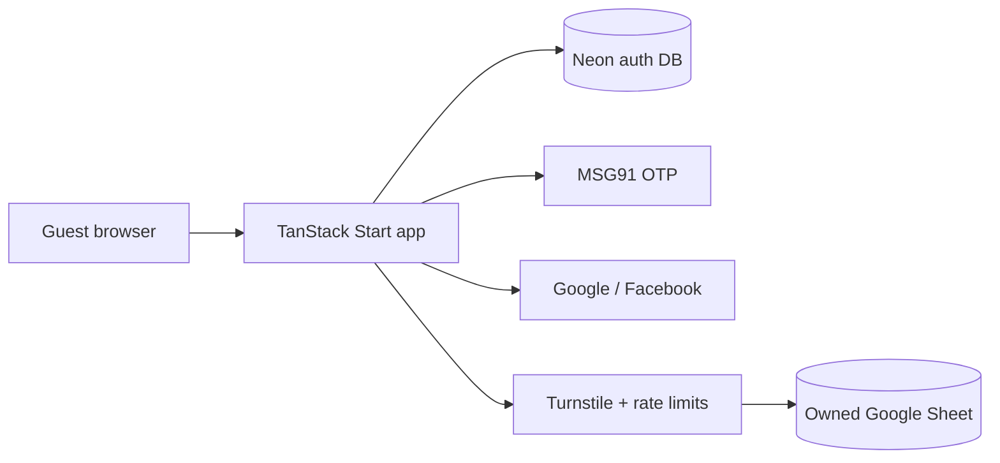

# Design Doc — Post-Migration Wedding Registry

**Audience:** humans + agents (Cursor, Devin, others)  
**Companion to:** [000-parent](./000-parent-tanstack-migration.md) and sub-PRPs  
**Purpose:** Describe how the product looks and works **after** migration, and **why** each architectural choice is worth it—including free/cheap deploy options.

---

## 1. End state: how it will look and feel

Guests still land on a single wedding registry page for Mitthu & Atin. The first viewport stays one composition—not a dashboard:

- Couple names as the hero brand signal
- Short invitation copy
- Dominant couple photo + wedding date / venue
- Refresh / sync status (quiet, not noisy)

Below that, the same jobs as today:

| Section | Post-migration |
|--------|----------------|
| Summary tiles | Available / reserved / all — filter the grid |
| Search + categories | Client UI, same mental model |
| Gift grid | Cards with price (INR), capacity meter (x/5), reserve / join / release |
| Suggest a gift | Side panel form → server mutation |
| Reserve dialog | Name + message; Turnstile when required |
| Sign in (new, optional) | Sticky / light entry: **phone OTP first**, then Google / Facebook — never blocks browsing |

**What guests should not notice:** that the backend moved. Reservations still work; shared registry still updates for everyone.

**What improves under the hood:** secrets leave the browser, bots get throttled, optional login can bind a reservation to a person (especially useful on phone), and the UI is built with maintainable React + ShadCN instead of one large `app.js`.

---

## 2. Before vs after (at a glance)

| Concern | Today (static + Apps Script) | After (TanStack Start) |
|--------|------------------------------|-------------------------|
| UI | HTML + CSS + monolithic `app.js` | React + ShadCN, same composition |
| Gift storage | Google Sheet via public Apps Script `/exec` | Same Sheet via **server-only** Sheets API + service account |
| Secrets | API URL (and optional admin key) can live in client `config.js` | Service account, admin key, auth secrets **only on server** |
| Transport | JSONP / fetch to Apps Script | Same-origin server functions |
| Release ownership | `localStorage` release codes | HttpOnly cookies + optional logged-in `userId` |
| Auth | None | Optional Better Auth (phone OTP, Google, Facebook) |
| Abuse controls | Minimal | Turnstile + CSRF + rate limits |
| Hosting | GitHub Pages / static nginx | Serverful or serverless Node-compatible host (see §7) |

Gift **data** stays in the Sheet you already own. Auth **identity** lives in a small Postgres (Neon). That split is intentional: Sheets for the couple’s editable registry table; a real DB for sessions.

---

## 3. Why migrate — benefits

### 3.1 Why React + TanStack Start

- **Component boundaries:** gift card, reserve dialog, suggest form, auth sheet become reusable pieces instead of string-built HTML in `app.js`.
- **Server functions:** call server code from the client with types, without standing up a separate Express API. Perfect for “hide the Sheet key, keep the UX snappy.”
- **SSR / routing when useful:** Start gives document shell + loaders; the registry can still feel like one page.
- **Ecosystem fit:** TanStack Query for list/refresh/optimistic updates (same spirit as today’s `saveGiftChange`, cleaner).

Plain static HTML was the right MVP. Once you need **secrets, auth, and bot protection**, you need a server. Start is a full-stack React home for that without rewriting as a heavy custom backend.

### 3.2 Why ShadCN (and a real component library)

- Accessible primitives (dialog, form controls, tabs) without inventing focus traps and aria from scratch.
- Theming via CSS variables—so Cursor can keep the wedding aesthetic, not a purple SaaS dashboard.
- Faster iteration for auth sheet + forms while **taste stays with Cursor** (Opus 5.5 + Claude design skill).

### 3.3 Why server-only Google Sheet access

Today’s Apps Script web app is convenient and free, but:

- The deployment URL is a **public write API** if someone finds it.
- Admin keys must never ship in a public repo or browser bundle; the old model makes that easy to get wrong.
- JSONP is a CORS workaround, not a security boundary.

After migration:

- A **service account** you control talks to **your** Sheet.
- Credentials live in host env vars; the browser only talks to **your** origin.
- Capacity checks, hashing of release codes, and admin actions run where users cannot rewrite them.

You keep the operational win of Sheets (couple can skim/edit gifts in a familiar UI) without exposing the write path.

### 3.4 Why optional login (phone OTP + socials)

Weddings in India are high-chaos guest traffic. Goals:

- **Frictionless default:** still reserve with just a name (no account required).
- **Better ownership when they want it:** phone OTP is the familiar India pattern; Google/Facebook cover guests who prefer one tap.
- **Cross-device release:** a logged-in reservation can be released from another phone; anonymous relies on HttpOnly cookie on that browser.
- **Less spoofing of “who reserved”** when identity is bound (still not bank-grade KYC—just better than a free-text name alone).

Login is a **capability**, not a gate.

### 3.5 Why CSRF, Turnstile, and rate limits up front

A public registry that accepts reserves and gift suggestions is a spam/abuse magnet (fake reserves filling all 5 slots, OTP burn, junk suggestions).

| Control | Why |
|--------|-----|
| **CSRF / same-origin** | Server functions are RPCs; browsers must not be tricked into firing mutations from another site. |
| **Turnstile** | Cheap human check on reserve / add / OTP send without a painful captcha UX. |
| **Rate limits** | Cap OTP SMS cost and reserve spam per IP/phone. |
| **HttpOnly release cookies** | Stops casual theft of release codes from XSS/`localStorage`. |

Doing this in the migration—not “later”—means Devin wires it once with the new server boundary instead of bolting it onto Apps Script.

### 3.6 Why Better Auth + Neon (not Sheets for users)

Sheets is a poor session store. Better Auth needs real rows for users, sessions, and OTP state. Neon’s free tier is enough for a wedding-scale guest list. Gifts remain in Sheets so the couple’s workflow does not become “learn a CMS.”

### 3.7 Why MSG91 for OTP

India-first SMS delivery and pricing fit wedding guest patterns better than treating Twilio as the only option. Swappable later; contract is Better Auth’s `sendOTP`.

---

## 4. Product principles that stay true

1. **Shared registry** — every guest sees the same gifts and reservation state.
2. **Anonymous-friendly** — no login wall.
3. **Max 5 co-reservations** per gift (server-enforced).
4. **Brand-first UI** — Cursor owns taste; Devin does not redesign.
5. **Secrets never in git or the JS bundle.**
6. **Couple can still use the Sheet** as the gift table of record.

---

## 5. Tooling split (reminder)

| Owner | Responsibility |
|--------|----------------|
| **Devin** | Scaffold, Sheets API, server functions, Better Auth, bot protection, deploy/cutover |
| **Cursor** | UI port, visual polish, auth sheet UX (Opus 5.5 + Claude design skill) |

See [`README.md`](./README.md) and PRPs 001–004.

---

## 6. Risks and honest tradeoffs

- **Sheets concurrency** is not Postgres transactions; we use checks + retry. Fine for wedding traffic; not for a marketplace.
- **OTP cost** — rate limits + Turnstile exist so SMS cannot be drained casually.
- **Instagram login** is deferred (Meta review friction); Facebook + Google + phone cover most guests.
- **Old `localStorage` release codes** do not migrate; brief cutover note for the couple.
- **Hosting is no longer pure GitHub Pages** — you need a host that runs server functions (still free at wedding scale on several platforms).

---

## 7. Where to deploy (including free / cheap)

TanStack Start needs a host that runs **server code** (server functions, auth routes)—not static-only GitHub Pages.

### Recommended free-friendly options

| Platform | Fit for this app | Free / hobby notes | Notes |
|----------|------------------|--------------------|--------|
| **Netlify** | Official TanStack Start partner; Vite plugin | Free plan with monthly credits; no card required for hobby use | Strong default for this stack |
| **Vercel** | First-class Start + Nitro support | Hobby plan for personal projects | Excellent DX; watch commercial/Hobby ToS if the site is “just a wedding” (usually fine) |
| **Cloudflare Workers** | Supported via Cloudflare Vite plugin | Generous free request tier | Great edge story; slightly different env/bindings model than Node |
| **Render / Fly.io / Railway** | Full Node containers | Free/low tiers change often; often need card | Good if you prefer Docker/`Dockerfile` control |
| **Neon** | Auth Postgres | Free tier typically enough for wedding auth | Not the web host—pair with one of the above |
| **Google Sheet** | Gift data | Free with your Google account | Unchanged operational model for the couple |

### Explicitly not enough alone

- **GitHub Pages / raw static S3** — no place to hide the service account or run Better Auth.
- **Apps Script as the public API** — what we are retiring for security/clarity.

### Practical recommendation for this wedding site

1. **Primary:** deploy the Start app on **Netlify** or **Vercel** (both free/hobby-capable and documented for TanStack Start).
2. **Auth DB:** **Neon** free tier.
3. **Sheet:** existing Google Drive Sheet + service account shared on that file.
4. **Turnstile:** Cloudflare free.
5. **MSG91:** pay-as-you-go SMS (budget a small OTP allowance; rate limits protect you).

Custom domain (current `CNAME`) points at the chosen host after cutover (PRP-004).

---

## 8. Success metrics (simple)

- Couple can open the Sheet and see reservations update.
- Two guests on different phones see the same availability.
- No service-account JSON in the repo or browser DevTools sources.
- Anonymous reserve still works in under a minute.
- Optional phone OTP works for `+91` without blocking the grid.
- Spam reserve / OTP flood is rate-limited in staging tests.

---

## 9. Doc map

| Doc | Role |
|-----|------|
| This file (`005`) | Vision, rationale, deploy story |
| [000](./000-parent-tanstack-migration.md) | Contracts and architecture |
| [001](./001-devin-scaffold-and-sheets.md) | Devin: scaffold + Sheets |
| [002](./002-devin-auth-and-bot-protection.md) | Devin: auth + bots |
| [003](./003-cursor-ui-port.md) | Cursor: UI / taste |
| [004](./004-devin-cutover.md) | Devin: production cutover |
